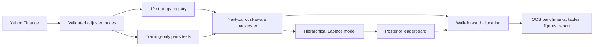
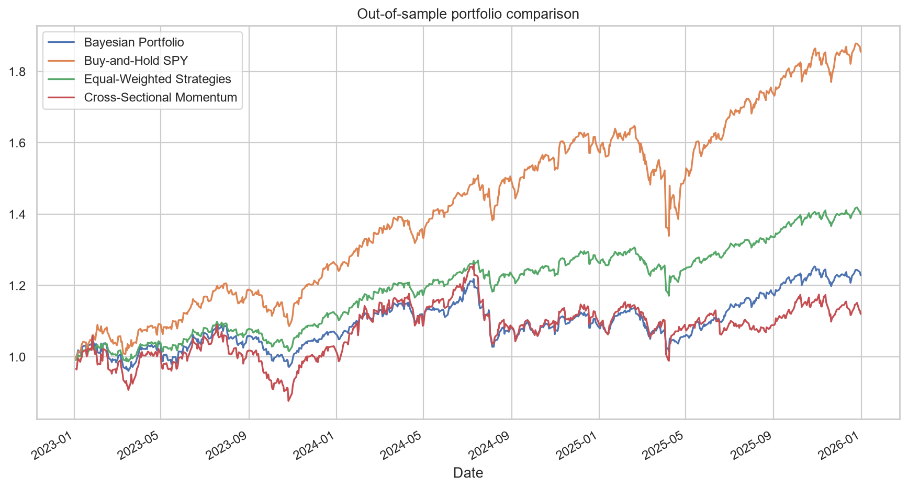
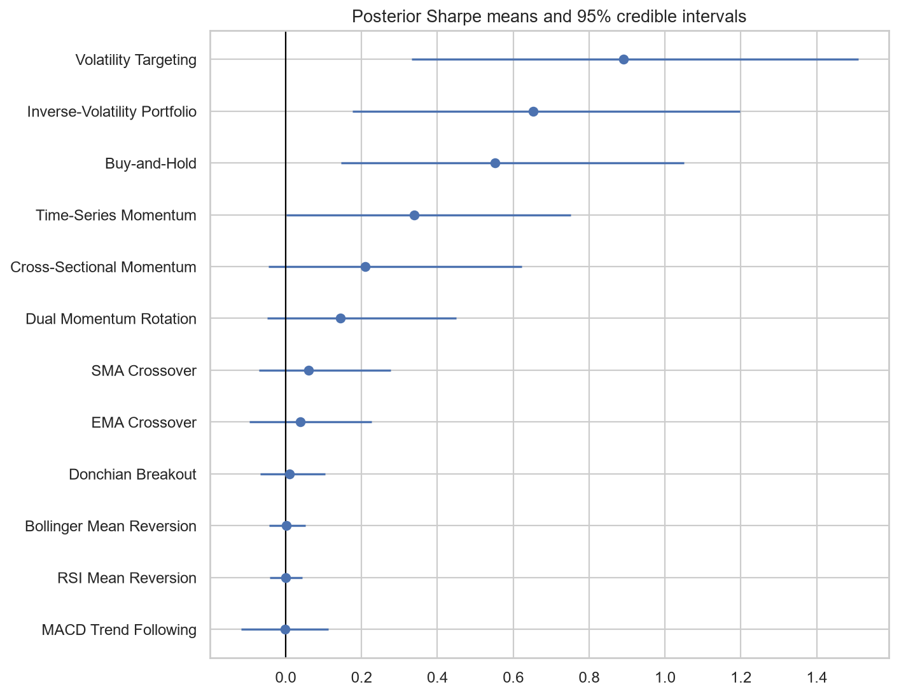

# Bayesian Analysis & Ranking of Investment Strategies

A reproducible quantitative-finance research system that downloads adjusted daily market data, backtests 12 conventional strategies plus statistically gated pairs trading, estimates uncertain performance with a heavy-tailed hierarchical Bayesian model, and compares chronological Bayesian-shrinkage selection with static benchmarks.

> Research software, not investment advice. Quick-mode output is exploratory. Market data remain subject to Yahoo Finance availability and terms.

## Architecture



## Strategies and execution

Buy-and-Hold; SMA 20/100; EMA 12/26; RSI mean reversion; MACD trend following; Bollinger mean reversion; time-series momentum; cross-sectional momentum; Donchian breakout; volatility targeting; dual-momentum rotation; inverse-volatility allocation; and an optional KO/PEP, XOM/CVX, or V/MA pairs strategy activated only after training-only Engle-Granger and residual ADF tests.

Signals execute on the next bar. The default fee is 10 bps and slippage is 5 bps per unit of turnover. Long-only and pairs gross exposure are capped at 1.0; unallocated weight is cash.

## Bayesian method

The model uses weekly compounded returns:

$$p(\theta\mid D)\propto p(D\mid\theta)p(\theta), \qquad r_{s,t}\sim Laplace(\mu_s,\sigma_s/\sqrt{2}), \qquad \mu_s=\mu_g+\tau z_s,\quad \sum_s z_s=0.$$

Partial pooling reduces unstable differences among noisy strategy means. Ranking reports posterior Sharpe, 95% credible intervals, $P(Sharpe>0)$, $P(best)$, expected rank, and $P(top\ 3)$. The heavy-tailed marginal likelihood does not fully represent serial or cross-strategy dependence; probabilities are conditional model summaries, not guaranteed forecasts.

## Reproduce

```bash
python -m venv .venv
# Windows: .venv\Scripts\activate
pip install -e ".[dev]"
pytest -q
ruff check .
python -m bayesian_investment.cli run --config config/quick.yaml
python -m bayesian_investment.cli run --config config/default.yaml
```

The full configuration requests 2015-01-01 through 2025-12-31 inclusive, with training through 2020, validation through 2022, and evaluation in 2023-2025. The 18-asset universe is SPY, QQQ, IWM, DIA, GLD, TLT, XLF, XLK, XLE, AAPL, MSFT, AMZN, KO, PEP, XOM, CVX, V, and MA.

## Genuine full-run results

The official experiment used 2,766 aligned observations and evaluated 2023-01-01 through 2025-12-31 without test-period parameter tuning. No candidate pair passed the training-only Bonferroni-adjusted selection rule, so pairs trading was correctly inactive.

| Out-of-sample portfolio | Total return | CAGR | Sharpe | Max drawdown | Daily 95% VaR |
|---|---:|---:|---:|---:|---:|
| Bayesian selection | 22.83% | 7.13% | 0.608 | -16.71% | 1.324% |
| Static best (cross-sectional momentum) | 12.00% | 3.87% | 0.305 | -21.45% | 1.864% |
| Equal-weighted strategies | 39.90% | 11.91% | 1.236 | -10.39% | 0.946% |
| Buy-and-Hold SPY | 85.50% | 23.00% | 1.426 | -18.76% | 1.415% |

Versus the predefined static-selection benchmark, the Bayesian portfolio improved Sharpe by **0.303**, reduced drawdown by **22.10%** (4.74 percentage points), and reduced VaR by **28.95%**. The historical 0.33 Sharpe claim was not supported; the 8% drawdown and 12% VaR claims were supported. Bayesian selection did not beat SPY or the equal-weighted strategy portfolio.

The posterior leaderboard favored volatility targeting (posterior Sharpe 0.890, 95% credible interval 0.332-1.509, 68.7% probability of best), followed by inverse volatility and buy-and-hold. The full model produced zero divergences, minimum bulk ESS 652, minimum tail ESS 1,179, and reported max R-hat 1.01. PyMC emitted a marginal unrounded R-hat warning, retained as a diagnostic caveat.

The 21-day moving-block bootstrap estimated an 85.6% probability that the Bayesian-minus-static Sharpe difference is positive, but its 95% interval (-0.190, 0.772) includes zero. Results, cost sensitivity, and claim verification are in `results/`; the narrative is in [reports/final_report.md](reports/final_report.md).





## Tests and limitations

Offline tests cover returns, accounting, execution lag, transaction costs, exposure limits, metrics, ADF, OLS, pairs sizing, posterior probability normalization, and a future-perturbation no-look-ahead check. CI excludes only the computationally heavier PyMC sampling smoke test.

Limitations include a current-constituent universe, simplified fills, no borrow/financing/market-impact model, provider revisions, conventional rather than exhaustively tuned parameters, and a marginal Bayesian likelihood. See the report for complete assumptions.
