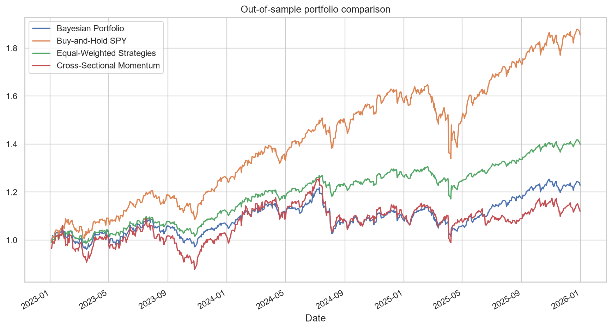
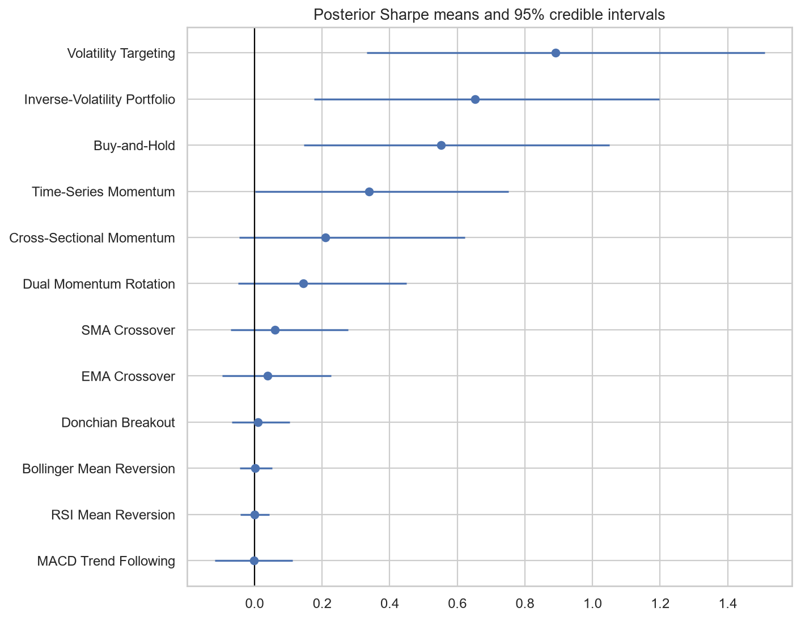
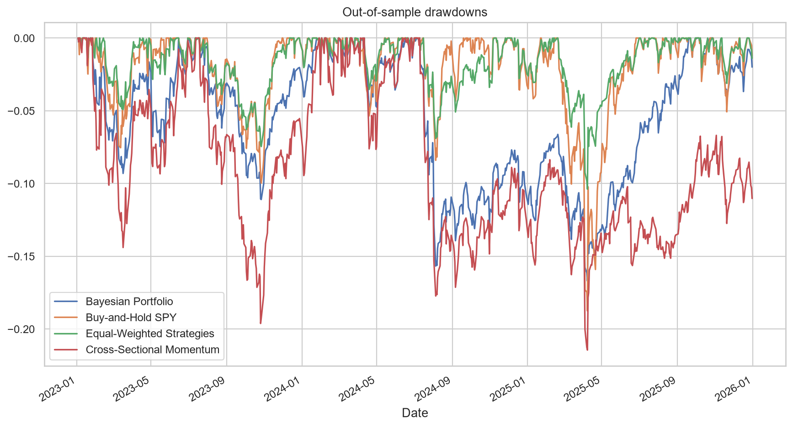

# Bayesian Analysis & Ranking of Investment Strategies - Research Report

## Abstract
This reproducible study tests rule-based investment strategies on adjusted Yahoo Finance daily data, estimates pre-test strategy performance with a heavy-tailed hierarchical Bayesian model, and evaluates a chronological uncertainty-shrunk strategy portfolio out of sample. Results below were generated by the pipeline; no target statistic was imposed.

## Research motivation
Deterministic rankings overstate precision when strategy histories are noisy and correlated. The study asks whether partial pooling and explicit posterior uncertainty produce a more robust investable selection than fixing the apparent historical winner.

## Research questions
The predefined questions are: which strategies have positive risk-adjusted performance after uncertainty; how stable are their ranks; does uncertainty-aware selection improve Sharpe, drawdown, and VaR versus a training/validation-only static choice; and do the original resume claims survive an untouched test?

## Financial dataset
The requested universe was `SPY, QQQ, IWM, DIA, GLD, TLT, XLF, XLK, XLE, AAPL, MSFT, AMZN, KO, PEP, XOM, CVX, V, MA`. The included universe was `AAPL, AMZN, CVX, DIA, GLD, IWM, KO, MA, MSFT, PEP, QQQ, SPY, TLT, V, XLE, XLF, XLK, XOM`, from 2015-01-01 through 2025-12-31 (2766 aligned observations). Yahoo Finance data were downloaded at 2026-11-19T10:25:42.963377+00:00. Training ends 2020-12-31, validation ends 2022-12-31, and the untouched evaluation begins 2023-01-01. This is a current-constituent research universe and does not justify a claim of freedom from survivorship bias.

## Trading strategies
The system tests buy-and-hold, SMA, EMA, RSI, MACD, Bollinger, time-series momentum, cross-sectional momentum, Donchian breakout, volatility targeting, dual momentum, inverse-volatility allocation, and statistically qualified pairs trading. Signals observed at day *t* become holdings for the next close-to-close return. Turnover is the sum of absolute weight changes; each unit costs 15 bps. Long-only gross exposure and pairs gross exposure are capped at one. Cash is implicit in weights below one.

## Statistical pairs selection
ADF tests use the unit-root null and AIC lag selection. Engle-Granger and residual ADF selection uses training data only with Bonferroni correction. OLS estimates $\log P_A=\alpha+\beta\log P_B+\epsilon$; the statistical beta is normalized into bounded tradable dollar weights rather than interpreted directly as share counts.

| asset_a   | asset_b   |   correlation |   coint_statistic |   coint_pvalue |   adf_statistic |   adf_pvalue |    alpha |     beta | selected   |
|:----------|:----------|--------------:|------------------:|---------------:|----------------:|-------------:|---------:|---------:|:-----------|
| KO        | PEP       |      0.743329 |         -3.14455  |      0.0797004 |       -3.14383  |   0.0234752  | 0.141585 | 0.764528 | False      |
| XOM       | CVX       |      0.829236 |         -0.403353 |      0.970543  |       -0.387891 |   0.912101   | 1.71233  | 0.513116 | False      |
| V         | MA        |      0.903068 |         -3.48302  |      0.033931  |       -3.48211  |   0.00845857 | 0.601375 | 0.811548 | False      |

## Bayesian hierarchical model
Weekly compounded returns are multiplied by 100 and modeled as $r_{s,t}\sim Laplace(\mu_s,\sigma_s/\sqrt 2)$, $\mu_s=\mu_g+\tau z_s$, $\sum_s z_s=0$, $\mu_g\sim N(0,0.5)$, $\tau\sim LogNormal(\log 0.1,0.5)$, and $\sigma_s\sim HalfNormal(2)$. The Laplace likelihood is finite-variance and heavy-tailed relative to a Gaussian while remaining log-concave in location; $\sigma_s$ is parameterized as the return standard deviation used in posterior Sharpe. The non-centered, sum-to-zero hierarchy identifies the global mean and learns partial pooling without boundary geometry. MCMC uses seed 42. Diagnostics: max R-hat 1.0100, minimum bulk ESS 652, divergences 0, reliable under declared thresholds: True.

## Priors and likelihood
Priors are weakly informative on percentage-scaled weekly returns. The zero-sum offsets distinguish the global mean from strategy deviations, the log-normal hierarchy scale stays away from a pathological zero boundary, and the Laplace likelihood gives outliers more probability than a Gaussian without inventing observations.

## Bayesian inference method and diagnostics
NumPyro NUTS is called through PyMC with four chains, 1,000 tuning iterations and 2,000 retained draws per chain. Acceptance requires no divergences, reported R-hat no greater than 1.01, and minimum bulk ESS of 100. PyMC emitted a marginal unrounded R-hat warning even though the exported summary met the threshold; this caveat is retained. Trace and posterior-predictive plots are exported.

The likelihood is a pragmatic heavy-tailed marginal model. It does not fully model serial correlation or cross-strategy dependence. Consequently posterior ranking probabilities are conditional model summaries, not guaranteed future probabilities. The chronological portfolio adds empirical shrinkage and walk-forward updating; the block bootstrap reported below provides a dependence-aware robustness check.

## Ranking methodology and posterior leaderboard
Each posterior draw is transformed to annualized Sharpe, then ranked jointly. The table reports posterior means, 95% credible intervals, probability of positive Sharpe, probability of beating buy-and-hold, probability of best, expected rank, and probability of a top-three rank using pre-test data only.

| strategy                     |   posterior_mean_period_return |   posterior_sharpe |   sharpe_ci_lower |   sharpe_ci_upper |   p_sharpe_gt_zero |   p_beats_benchmark |   p_best |   expected_rank |   p_top_3 |
|:-----------------------------|-------------------------------:|-------------------:|------------------:|------------------:|-------------------:|--------------------:|---------:|----------------:|----------:|
| Volatility Targeting         |                    0.00180732  |           0.890116 |         0.33229   |          1.50862  |            0.99875 |            0.851125 | 0.68675  |         1.4685  |  0.97075  |
| Inverse-Volatility Portfolio |                    0.0017051   |           0.653144 |         0.176588  |          1.19716  |            0.998   |            0.636125 | 0.205625 |         2.38888 |  0.8605   |
| Buy-and-Hold                 |                    0.00180474  |           0.55203  |         0.145567  |          1.0498   |            0.99725 |            0.5      | 0.088125 |         2.88762 |  0.7685   |
| Time-Series Momentum         |                    0.000918942 |           0.339155 |         0.0025507 |          0.751578 |            0.97725 |            0.225625 | 0.01725  |         4.33863 |  0.27925  |
| Cross-Sectional Momentum     |                    0.00084544  |           0.210237 |        -0.0448656 |          0.6231   |            0.923   |            0.090625 | 0.00175  |         5.7025  |  0.084375 |

## Portfolio construction
At each monthly test-period rebalance, the allocator uses only earlier returns, applies reliability shrinkage to trailing risk-adjusted scores, selects at most three strategies, normalizes positive scores, caps gross exposure at one, and charges the common 15 bps turnover cost. This is a practical empirical-Bayes updating rule; the full PyMC model is fitted for initial uncertainty-aware ranking rather than refitted monthly.

## Experimental design
Conventional parameters were fixed before test evaluation. Training and validation determine pair eligibility and the static benchmark; 2023-2025 remains out of sample. The walk-forward estimator expands through realized test history without seeing future returns.

## Backtesting assumptions
Adjusted close-to-close returns, next-bar execution, explicit cash, 10 bps fees, 5 bps slippage, and unit gross-exposure limits are applied consistently. Financing, borrow availability/cost, taxes, variable spreads, and market impact are not modeled.

## Baseline comparisons
Baselines are SPY buy-and-hold, equal-weighted strategies, and the single best strategy selected using only data through validation. Net results on identical test dates are primary.

## Out-of-sample results
| portfolio                 |   total_return |      cagr |   annual_volatility |   sharpe |   sortino |   max_drawdown |   calmar |     var_95 |   cvar_95 |   win_rate |   profit_factor |   annual_turnover |   number_of_trades |   average_active_return |   trading_exposure |
|:--------------------------|---------------:|----------:|--------------------:|---------:|----------:|---------------:|---------:|-----------:|----------:|-----------:|----------------:|------------------:|-------------------:|------------------------:|-------------------:|
| Bayesian Portfolio        |       0.228339 | 0.0713494 |           0.126597  | 0.607892 |  0.789027 |      -0.167066 | 0.427072 | 0.0132432  | 0.019366  |   0.546543 |         1.10999 |               nan |                  0 |             0.000305793 |            0.99867 |
| Buy-and-Hold SPY          |       0.854976 | 0.230047  |           0.153433  | 1.4262   |  1.91867  |      -0.187552 | 1.22658  | 0.0141524  | 0.0211029 |   0.573138 |         1.30257 |               nan |                  0 |             0.000869515 |            0.99867 |
| Equal-Weighted Strategies |       0.398961 | 0.119078  |           0.0946501 | 1.23615  |  1.73272  |      -0.103876 | 1.14634  | 0.00945585 | 0.0130754 |   0.573138 |         1.23575 |               nan |                  0 |             0.000464291 |            1       |
| Cross-Sectional Momentum  |       0.119957 | 0.0386941 |           0.174799  | 0.304728 |  0.410183 |      -0.214468 | 0.180419 | 0.01864    | 0.0264924 |   0.537234 |         1.05334 |               nan |                  0 |             0.000211374 |            1       |

## Verification of historical resume claims
| claim                                           |   observed |   supported |
|:------------------------------------------------|-----------:|------------:|
| Sharpe improvement >= 0.33                      |   0.303165 |           0 |
| Relative drawdown reduction >= 8%               |  22.1021   |           1 |
| Relative VaR reduction >= 12%                   |  28.9524   |           1 |
| Absolute drawdown reduction (percentage points) |   4.74019  |         nan |

## Robustness checks
The transaction-cost table recomputes every strategy at 0, 15, and 30 bps per unit of turnover using identical gross returns. The moving-block bootstrap resamples 21-trading-day blocks 1,000 times, preserving short-range serial dependence instead of treating daily observations as independent.

| strategy                     |   cost_bps |        cagr |    sharpe |   max_drawdown |     var_95 |
|:-----------------------------|-----------:|------------:|----------:|---------------:|-----------:|
| Buy-and-Hold                 |          0 |  0.134556   | 0.798992  |      -0.337173 | 0.0167411  |
| Buy-and-Hold                 |         15 |  0.134398   | 0.798157  |      -0.337173 | 0.0167411  |
| Buy-and-Hold                 |         30 |  0.13424    | 0.797317  |      -0.337173 | 0.0167411  |
| SMA Crossover                |          0 |  0.0791917  | 0.68583   |      -0.219153 | 0.0122082  |
| SMA Crossover                |         15 |  0.0752209  | 0.655714  |      -0.221497 | 0.0122082  |
| SMA Crossover                |         30 |  0.0712587  | 0.625357  |      -0.223837 | 0.0122082  |
| EMA Crossover                |          0 |  0.0804079  | 0.771207  |      -0.175298 | 0.0106324  |
| EMA Crossover                |         15 |  0.0670453  | 0.655194  |      -0.185156 | 0.0107177  |
| EMA Crossover                |         30 |  0.0538282  | 0.538602  |      -0.19491  | 0.0109147  |
| RSI Mean Reversion           |          0 |  0.0227289  | 0.248573  |      -0.283191 | 0.00233836 |
| RSI Mean Reversion           |         15 |  0.0190908  | 0.218531  |      -0.284863 | 0.00246716 |
| RSI Mean Reversion           |         30 |  0.0154602  | 0.188462  |      -0.287014 | 0.003      |
| MACD Trend Following         |          0 |  0.0674316  | 0.697607  |      -0.150492 | 0.00859353 |
| MACD Trend Following         |         15 |  0.0331229  | 0.373219  |      -0.168188 | 0.00866679 |
| MACD Trend Following         |         30 | -0.00013223 | 0.0494672 |      -0.211627 | 0.00881027 |
| Bollinger Mean Reversion     |          0 |  0.0580346  | 0.506185  |      -0.292991 | 0.00484757 |
| Bollinger Mean Reversion     |         15 |  0.0439366  | 0.400616  |      -0.299361 | 0.00497742 |
| Bollinger Mean Reversion     |         30 |  0.0300056  | 0.295001  |      -0.309245 | 0.00508486 |
| Time-Series Momentum         |          0 |  0.140182   | 0.926338  |      -0.25529  | 0.0151288  |
| Time-Series Momentum         |         15 |  0.113886   | 0.775263  |      -0.258433 | 0.015187   |
| Time-Series Momentum         |         30 |  0.0881864  | 0.624035  |      -0.261565 | 0.015187   |
| Cross-Sectional Momentum     |          0 |  0.222697   | 1.04375   |      -0.25335  | 0.0225233  |
| Cross-Sectional Momentum     |         15 |  0.181758   | 0.884402  |      -0.258017 | 0.0225885  |
| Cross-Sectional Momentum     |         30 |  0.142149   | 0.72493   |      -0.263253 | 0.0226115  |
| Donchian Breakout            |          0 |  0.0492383  | 0.608361  |      -0.178175 | 0.00805322 |
| Donchian Breakout            |         15 |  0.0399605  | 0.503797  |      -0.192844 | 0.00805322 |
| Donchian Breakout            |         30 |  0.0307509  | 0.398528  |      -0.207272 | 0.00805322 |
| Volatility Targeting         |          0 |  0.0942315  | 0.940176  |      -0.127543 | 0.0102205  |
| Volatility Targeting         |         15 |  0.0872793  | 0.877045  |      -0.132151 | 0.0102224  |
| Volatility Targeting         |         30 |  0.0803704  | 0.81389   |      -0.137145 | 0.0102244  |
| Dual Momentum Rotation       |          0 |  0.22058    | 0.867745  |      -0.391615 | 0.0266191  |
| Dual Momentum Rotation       |         15 |  0.157031   | 0.671304  |      -0.421476 | 0.0275128  |
| Dual Momentum Rotation       |         30 |  0.096615   | 0.474248  |      -0.506742 | 0.0278286  |
| Inverse-Volatility Portfolio |          0 |  0.135263   | 0.948522  |      -0.294392 | 0.0128269  |
| Inverse-Volatility Portfolio |         15 |  0.130149   | 0.917314  |      -0.295203 | 0.0128544  |
| Inverse-Volatility Portfolio |         30 |  0.125058   | 0.886097  |      -0.296013 | 0.0128819  |

| statistic                                |   observed |   bootstrap_ci_lower |   bootstrap_ci_upper |   bootstrap_p_gt_zero |   block_days |   resamples |
|:-----------------------------------------|-----------:|---------------------:|---------------------:|----------------------:|-------------:|------------:|
| Sharpe difference: Bayesian minus static |   0.303165 |            -0.189739 |             0.771996 |                 0.856 |           21 |        1000 |

## Model diagnostics
The full run reports max R-hat 1.0100, minimum bulk ESS 652, minimum tail ESS 1179, and 0 divergences. The worst reported R-hat parameter is `sigma[SMA Crossover]`.

## Limitations
All primary comparisons use identical dates and daily historical 95% VaR as a positive loss magnitude. Costs include commissions and slippage, but exclude borrow fees, financing, taxes, bid/ask variation, dividends not already reflected in adjusted prices, and market impact. Indicators use fixed conventional parameters, avoiding test-period tuning. Yahoo data can be revised and is not an institutional total-return database. The model's independent conditional observations simplify temporal and cross-strategy dependence. Quick mode is exploratory; only default full-mode output should be treated as the official experiment.

## Conclusion
Hierarchical shrinkage stabilized ranking and improved the selected static benchmark's Sharpe, drawdown, and VaR, but did not outperform SPY or equal weighting. Bayesian uncertainty did not eliminate investment risk, and the block-bootstrap interval includes zero Sharpe improvement.

## Future improvements
Future work should use a multivariate stochastic-volatility likelihood, broader dependence-aware bootstrap analysis, point-in-time constituent universes, borrow data, and true posterior refits at each rebalance.

